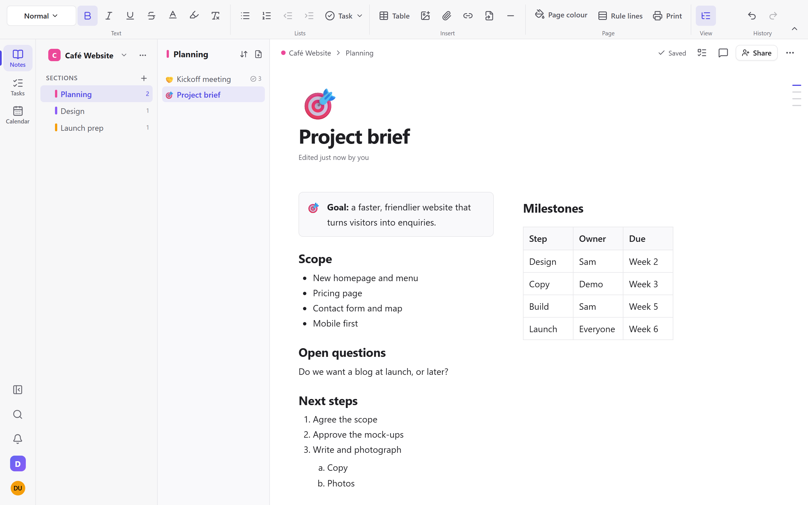
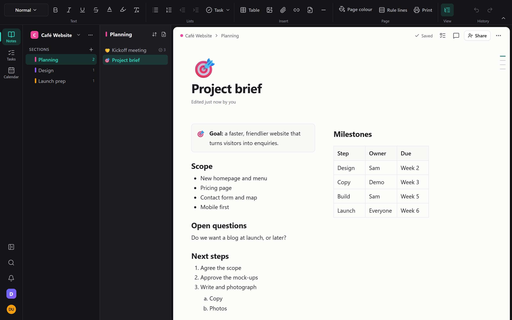
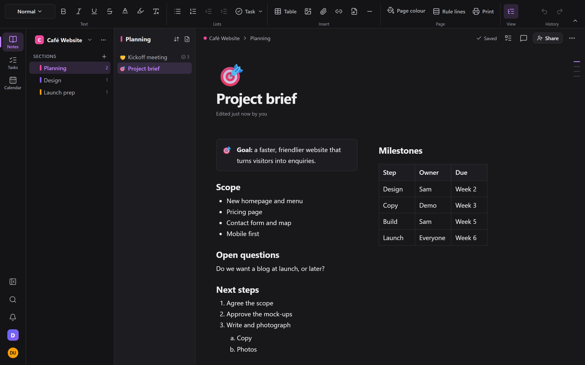
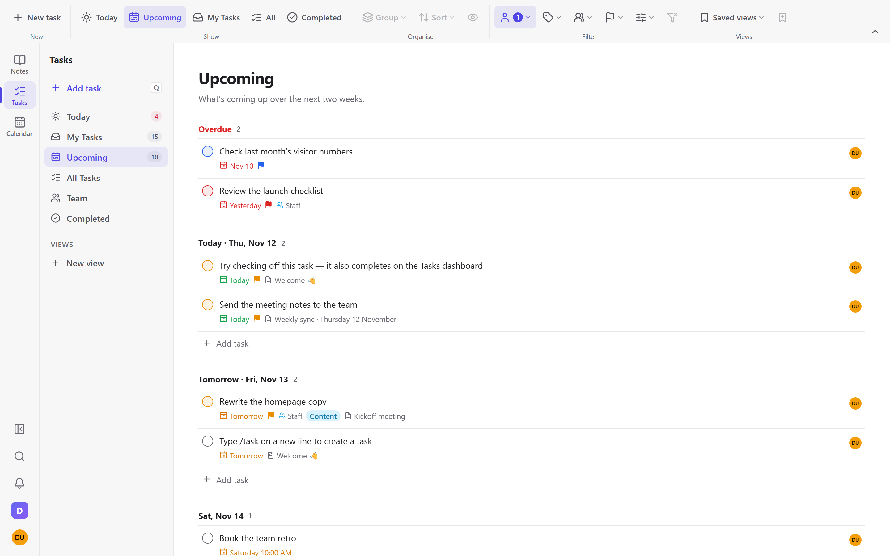
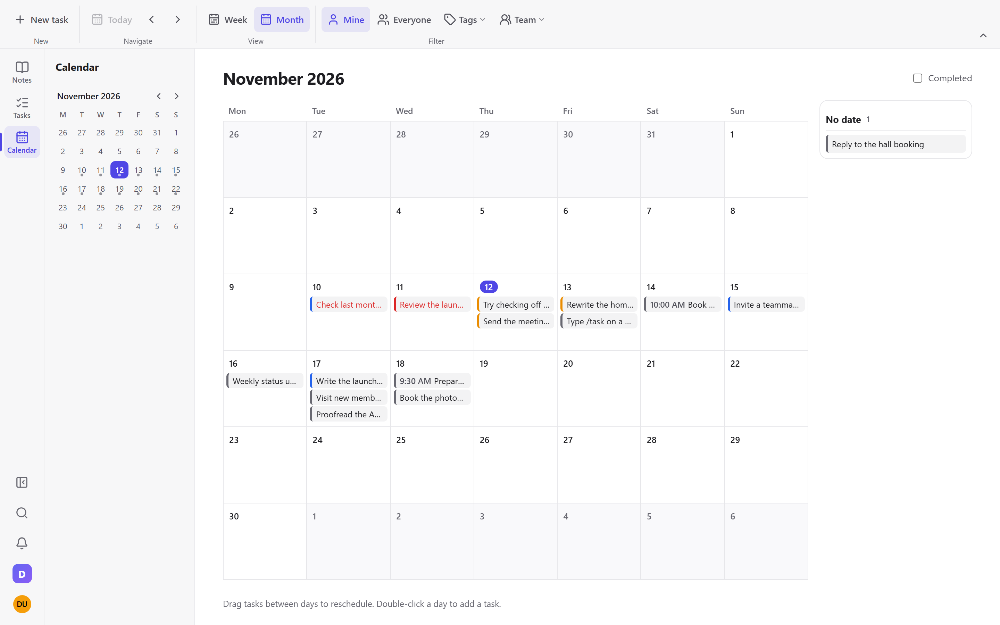
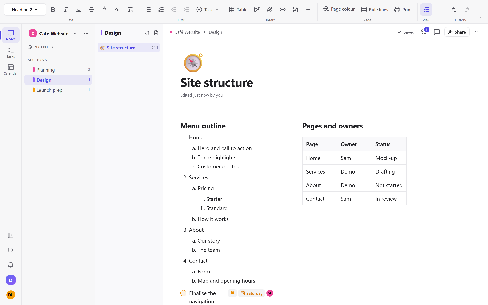
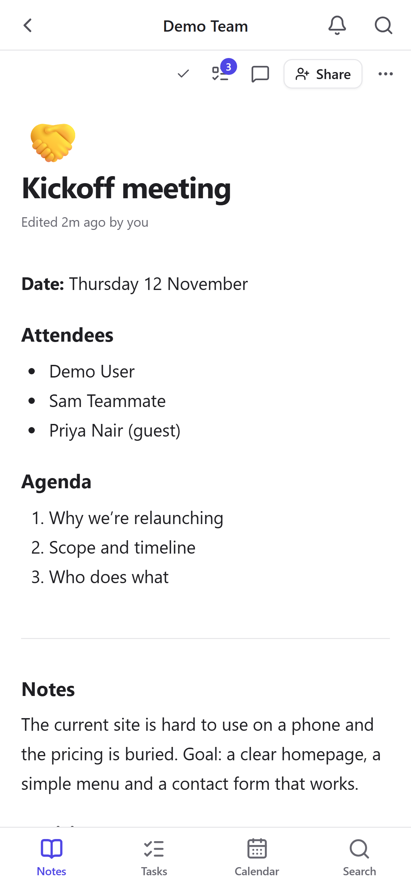
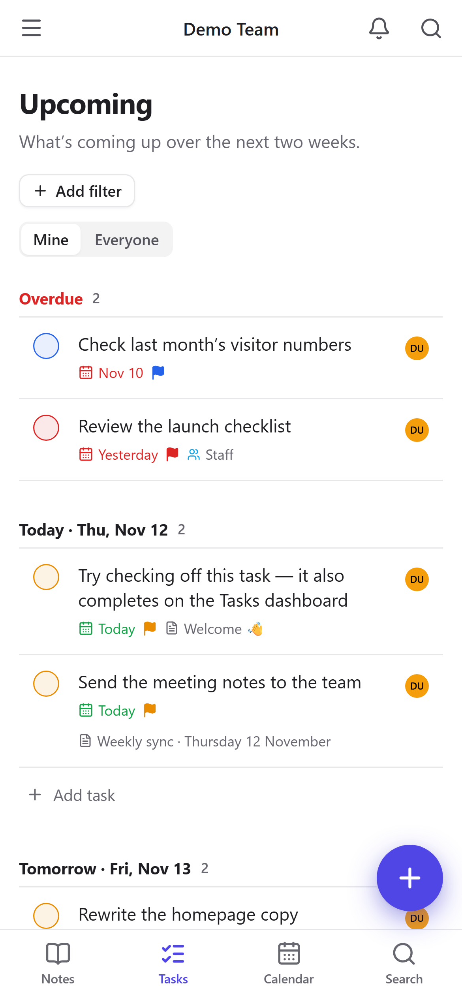

# Notivelo

**Notes and tasks, the OneNote way.** Notebooks, sections and pages on a free-form canvas, with tasks that live in your notes, a calendar, sharing and printing. Self-hosted, and on the web, Windows, Mac, iPhone, iPad and Android.

<p align="center">
  
</p>

**[Open the web app](https://notes.devswartz.com)** · **[Download for Windows and Mac](https://github.com/devswartz/NoteApp/releases/latest)** · iPhone and iPad: App Store, coming soon · [Privacy](https://notes.devswartz.com/privacy) · [Support](https://notes.devswartz.com/support)

## Features

**Canvas pages and ribbon**
- Click anywhere on a page and type. Drag boxes around, resize them, add tables, images and files. Word-style numbered outlines (1, a, i) with drag handles to reorder.
- A OneNote-style ribbon that changes with the view, page colour and rule lines, page version history, and a phone layout with a floating toolbar.

**Tasks and calendar**
- Type `/task` in a note and it becomes a real task: assignee, due date and time, priority, tags, recurrence and subtasks. It shows on your dashboard and stays linked to its page.
- Today, My tasks, Upcoming, Team and Completed views, filters and saved views, a month and week calendar, reminders and a private calendar feed.

**Sharing and collaboration**
- Share a notebook with your workspace, or a single page with anyone by email, as view or edit. Live co-editing with cursors, comments, and tasks on shared pages.
- Roles for owners, admins, members and viewers. Works offline and syncs when you reconnect.

**Templates**
- Meeting notes, project and daily journal, your own templates, and a default template per section.

**Printing**
- Print a page, a selection, a section or a notebook, or just a contents sheet. Save as PDF from the same dialog.

**Themes**
- Light, Dark, Hybrid (dark ribbon around a paper-like page) or System, with eight accent colours.

**OneNote import**
- Bring in pages from OneNote and keep their layout, box positions and tables.

**Privacy**
- Your notes live on a server you control. Files need sign-in, there is an Export my data button, and the iPhone app has Apple's privacy manifest. No ads and no tracking. See the [Privacy Policy](https://notes.devswartz.com/privacy).

Full detail by release is in the [changelog](CHANGELOG.md), and the [user guide](docs/USER_GUIDE.md) explains how to use it.

## Screenshots

| Hybrid theme | Dark theme |
|---|---|
|  |  |

| Tasks | Calendar |
|---|---|
|  |  |

| Numbered outline and table | iPhone: a page | iPhone: tasks |
|---|---|---|
|  |  |  |

## Get it

- **Web:** [notes.devswartz.com](https://notes.devswartz.com). It installs as an app from your browser.
- **Windows and Mac:** download the latest installer from [Releases](https://github.com/devswartz/NoteApp/releases/latest). The app updates itself.
- **iPhone and iPad:** on the App Store, coming soon.
- **Android:** see [docs/MOBILE.md](docs/MOBILE.md).

## Self-hosting

One container runs everything: the API, real-time collaboration, the web app and the reminder worker. Data is SQLite plus files in one volume.

```bash
docker run -d -p 3001:3001 -v notivelo-data:/data \
  -e NODE_ENV=production \
  -e PUBLIC_URL=https://notes.example.com \
  -e JWT_SECRET="$(openssl rand -hex 64)" \
  ghcr.io/devswartz/noteapp:prod
```

Put it behind HTTPS with WebSocket upgrade allowed. Email, web push and mobile push are optional and configured through environment variables. The full list, the health check and the volume layout are in [docs/DEPLOY_CONTRACT.md](docs/DEPLOY_CONTRACT.md), and releasing is in [docs/RELEASING.md](docs/RELEASING.md). The package may be private, in which case sign in to `ghcr.io` first.

## Development

Needs Node 22.

```bash
npm ci
SEED_DEMO=1 DEMO_PASSWORD=demo-pass-123 npm run dev
# open http://localhost:5173 and sign in as demo@example.com / demo-pass-123,
# or create your own account
```

`npm run dev` runs the API on :3001 and Vite on :5173. Without `SEED_DEMO`, just create an account.

```bash
npm run typecheck   # tsc over client, server, shared and tests
npm test            # unit + API tests (node:test, in-memory SQLite)
npm run test:e2e    # Playwright end-to-end suite
npm run build       # production build into dist/
npm start           # production server: API, WebSockets and the web app on one port
```

Desktop: `npm run desktop:dev` (needs Rust). Mobile: `npm run mobile:ios` / `npm run mobile:android` (needs Xcode / Android Studio).

Store and README images are made by `scripts/store-assets/` (capture with Playwright against a demo server, then composite); see the header of each script.

## Documentation

| Doc | What's in it |
|---|---|
| [docs/USER_GUIDE.md](docs/USER_GUIDE.md) | How to use the app: notes, tasks, views, quick add, reminders, sharing, shortcuts |
| [ARCHITECTURE.md](ARCHITECTURE.md) | How it's built: stack, folder layout, data model, auth, sync, platform adapter, API |
| [docs/DEPLOY_CONTRACT.md](docs/DEPLOY_CONTRACT.md) | The hosting interface: image, ports, environment, volumes, health check |
| [docs/LAUNCH_CHECKLIST.md](docs/LAUNCH_CHECKLIST.md) | Step by step from `main` to staging, prod, and the signed desktop and mobile apps |
| [docs/RELEASING.md](docs/RELEASING.md) | Releasing the server image (CI, GHCR, staging and production) |
| [docs/DESKTOP.md](docs/DESKTOP.md) | The Mac and Windows app: building, signing, notarisation, auto-update |
| [docs/MOBILE.md](docs/MOBILE.md) | The iPhone/Android app: building, push, widgets, store secrets |
| [docs/REMINDERS.md](docs/REMINDERS.md) | Recurrence rules, the reminder scheduler and delivery channels |
| [docs/QA.md](docs/QA.md) | The end-to-end test suite and the bug list |
| [CHANGELOG.md](CHANGELOG.md) | What changed, by release |
| [PLAN.md](PLAN.md) | Product scope, platforms and roadmap |
