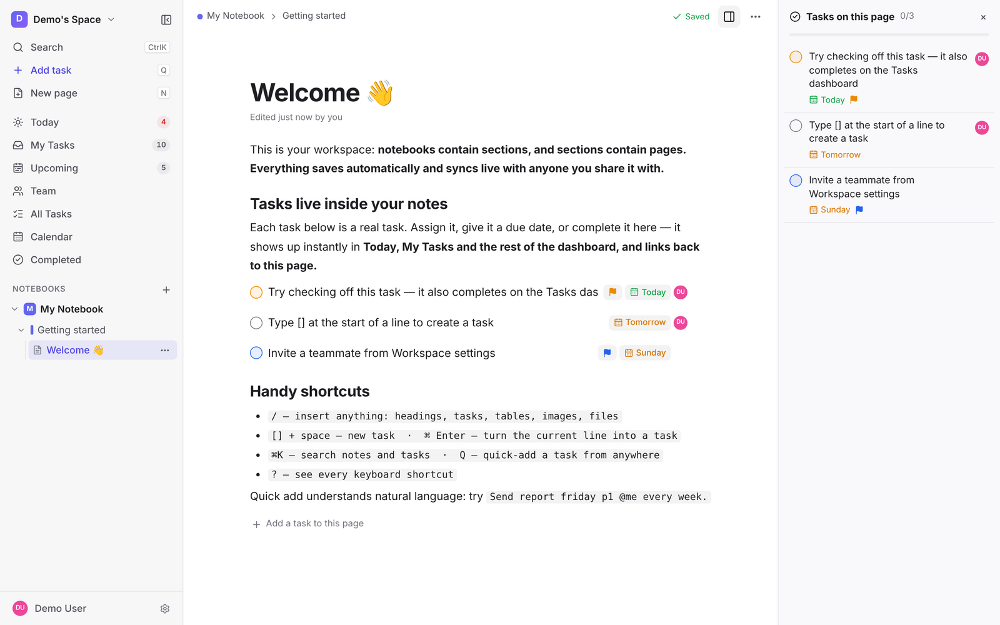
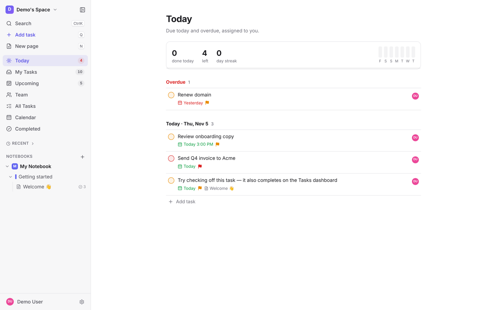
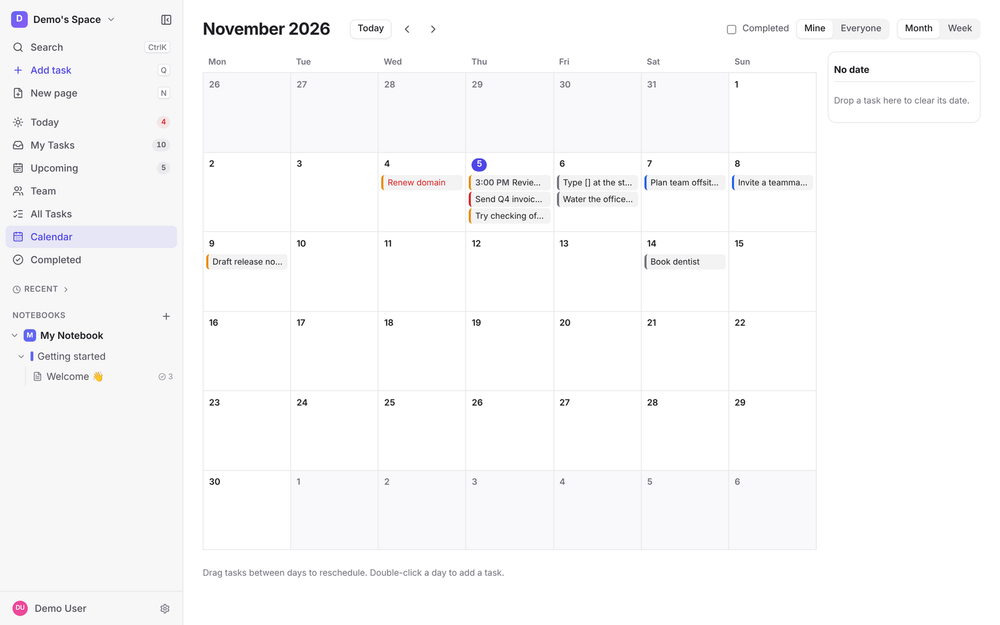
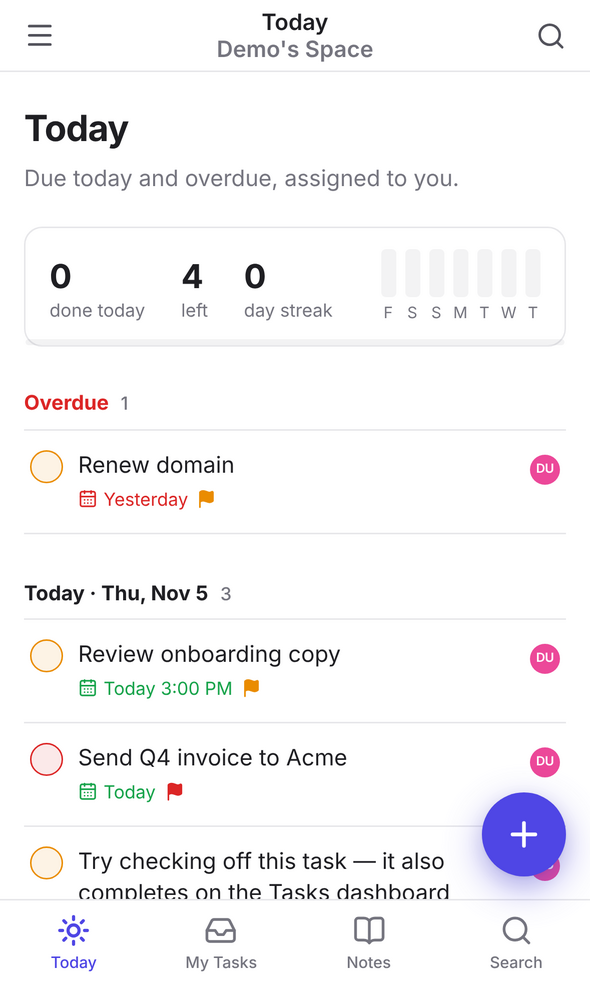

# Notivelo

Collaborative notes with built-in task management. Notebooks, sections and pages like OneNote, a block editor like Notion, and tasks like Todoist. **A task you write inside a note is a real task**: it shows up on your dashboard, stays linked to its note, and stays in sync everywhere it appears.

Built for a small team (about 2–10 people). Self-hosted, invite-only, and available on the web, macOS, Windows, iPhone and Android.



| Today | Calendar | Mobile |
|---|---|---|
|  |  |  |

## Features

**Notes**
- Workspaces → notebooks → sections → pages, with drag-and-drop reordering and moving. Favourites, recent pages, context menus and a resizable sidebar.
- Block editor: headings, lists, checklists, tables, callouts, toggles, quotes, dividers, code blocks with highlighting, links (⌘K), images (resizable) and file attachments.
- Page templates (meeting notes, project, daily journal), `[[` page links with backlinks ("Linked from"), `/` slash menu, Markdown shortcuts, block drag handles, page icons, autosave with a save-status indicator, and page move and copy.
- Page version history with preview and restore.
- Real-time co-editing with live cursors and presence.
- Works offline: the app opens without a connection, notes stay editable and sync when you reconnect, and tasks are readable from a local cache.

**Tasks**
- Type `/task` in a note, or press ⌘↵ (Ctrl+Enter on Windows and Linux) on a line, to make it a task. You can also add standalone tasks from anywhere with **Q**.
- Each task has an assignee, a due date and time, a priority (P1–P4) and recurrence. Edit it from the note or the dashboard; it is the same task in both places.
- **Natural-language quick add:** `Send invoice tomorrow 3pm p1 @sam every month`.
- **Dashboard:** Today (including overdue, with a progress strip), My Tasks, Upcoming, Team, All (filter, sort, group, saved views), Calendar (month and week, drag to reschedule) and Completed.
- **Keyboard-driven task lists** (J/K, X, D, A, 1–4), bulk actions with undo, and one level of subtasks with progress.
- **Recurrence:** daily, weekdays, every N weeks on chosen days, monthly (on a date, or e.g. the 2nd Tuesday), yearly, until a date or N times, or "after completion".
- **Reminders** by web push, email or mobile push, with snooze, quiet hours, a daily digest email and a private calendar feed (.ics) for Apple or Google Calendar.

**Team**
- Email invites. Workspace roles: owner, admin, member and viewer.
- Notebooks shared with the whole workspace, or private to you plus people you choose.
- Task changes are pushed live to everyone who can see them.

**Everywhere**
- ⌘K search across pages and tasks (ranked full-text), plus a command palette.
- Keyboard-first: `?` lists every shortcut. Light, dark or system theme.
- **Web/PWA**, a **desktop app** (menu bar icon, global quick capture ⌥⌘N, native notifications, auto-update) and **mobile apps** (push reminders, share sheet, Today widget, Face ID lock).

New here? Read the **[user guide](docs/USER_GUIDE.md)**.

## Quick start (development)

Needs Node 22.

```bash
npm ci
SEED_DEMO=1 DEMO_PASSWORD=demo-pass-123 npm run dev
# open http://localhost:5173 and sign in as demo@example.com / demo-pass-123,
# or create your own account
```

`npm run dev` runs the API on :3001 and Vite on :5173. Without `SEED_DEMO`, just create an account.

```bash
npm run typecheck   # tsc over client, server, shared and tests
npm test            # unit + API tests (node:test, in-memory SQLite)
npm run test:e2e    # Playwright end-to-end suite
npm run build       # production build into dist/
npm start           # production server: API, WebSockets and the web app on one port
```

Desktop: `npm run desktop:dev` (needs Rust). Mobile: `npm run mobile:ios` / `npm run mobile:android` (needs Xcode / Android Studio).

## Documentation

| Doc | What's in it |
|---|---|
| [docs/USER_GUIDE.md](docs/USER_GUIDE.md) | How to use the app: notes, tasks, views, quick add, reminders, sharing, shortcuts |
| [ARCHITECTURE.md](ARCHITECTURE.md) | How it's built: stack, folder layout, data model, auth, sync, platform adapter, API |
| [docs/DEPLOY_CONTRACT.md](docs/DEPLOY_CONTRACT.md) | The hosting interface: image, ports, environment, volumes, health check |
| [docs/LAUNCH_CHECKLIST.md](docs/LAUNCH_CHECKLIST.md) | Step by step from `main` to staging, prod v0.1.0, and the signed desktop and mobile apps |
| [docs/RELEASING.md](docs/RELEASING.md) | Releasing the server image (CI, GHCR, staging and production) |
| [docs/DESKTOP.md](docs/DESKTOP.md) | The macOS/Windows app: building, signing, notarisation, auto-update |
| [docs/MOBILE.md](docs/MOBILE.md) | The iPhone/Android app: building, push, widgets, store secrets |
| [docs/REMINDERS.md](docs/REMINDERS.md) | Recurrence rules, the reminder scheduler and delivery channels |
| [docs/QA.md](docs/QA.md) | The end-to-end test suite and the bug list |
| [CHANGELOG.md](CHANGELOG.md) | What changed, by release |
| [PLAN.md](PLAN.md) | Product scope, platforms and roadmap |

Screenshots are generated by `scripts/docs-screenshots.cjs` against a demo build.
