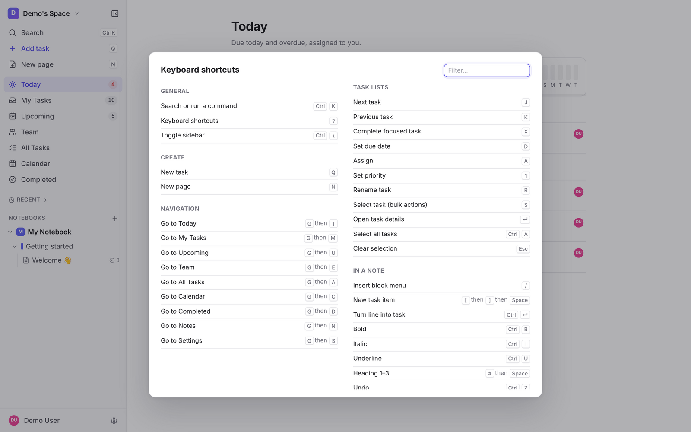

# User guide

A short tour of Notivelo for the team. Shortcuts use ⌘ (Mac). On Windows and Linux, use Ctrl instead.

## The basics: workspaces, notebooks, sections, pages

- A **workspace** is a team or a context (yours, "Demo Team", …). Switch workspaces from the name at the top of the sidebar.
- A workspace holds **notebooks**, a notebook holds **sections**, and a section holds **pages**. Pages are where you write.
- Create one with **+** next to *Notebooks* in the sidebar, or press **N** for a new page.
- Drag things in the sidebar to reorder them or move them between sections and notebooks. Right-click (or use ⋯) to rename, move, copy, add to favourites or delete.
- **Favourites** and **Recent** at the top of the sidebar get you back to pages quickly. Drag the sidebar's edge to resize it; ⌘\ hides it.

## Writing

- Just type. Everything saves automatically ("Saved" at the top right), and other people's edits and cursors show up live.
- Press **/** for the block menu: text, headings 1–3, bulleted, numbered and checklist lists, task, table, callout, toggle, quote, code block, divider, image, file attachment and link.
- Markdown shortcuts work: `#`, `##`, `###` for headings, `-` or `*` for bullets, `1.` for numbers, `>` for quotes, ``` for code.
- A new, empty page offers **Start with a template**: meeting notes, project, or daily journal, followed by **Your templates**, the ones saved in this workspace.
- **Save your own template:** open the page's ⋯ menu and choose **Save as template…**. Everyone in the workspace can then use it (a page in a *private* notebook makes a template only you can see). Tasks on the page become **new tasks** each time the template is used (title, priority, notes and subtasks only, open, assigned to you, no due date), and attachments are copied. The original page and tasks are never touched. In the picker, the pencil renames a template and the bin deletes it; only its creator or a workspace admin sees those buttons. Pages already made from it keep their content.
- Type **`[[`** to link to another page: pick one, or type a new title to create that page. Each page's **Linked from** panel lists the pages that link to it.
- **⌘K** while text is selected makes a web link. Drag the handle at the left of a block to move it. Drag an image's corner to resize it.
- **Version history:** the page's ⋯ menu → *Version history* lists automatic snapshots. Preview any of them and **Restore** it; restoring is one edit that everyone sees, and it can be undone.
- The app opens offline, even from a cold start. Pages you've opened stay editable offline and sync when you reconnect; tasks are read-only offline. A banner tells you when you're offline, and a prompt offers to reload when a new version of the app is available.

## Comments and mentions

- Select text and click **Comment** in the formatting bubble to start a thread on it. The comments panel shows every thread on the page; reply there, **resolve** a thread when it's done, or reopen it.
- Type **@** and a name in a comment to mention someone. A notification inbox to collect mentions and replies is on its way.

## Tasks inside notes

- Type **`/task`** and press Enter to insert a task, or put the cursor on any line and press **⌘↵** to turn it into one.
- A task in a note is **the real task**. Its due date, assignee, priority and done state are the same wherever it appears: in the note, on Today, on the calendar. Check it off anywhere and it's done everywhere.
- Click a task's chips (date, flag, avatar) to change them, or open it for details: description, reminders and recurrence.
- The **Tasks on this page** panel (the icon at the top right of a page) lists the page's tasks.
- Deleting a task line from a note doesn't delete the task. It becomes a standalone task. Deleting a page does the same for its tasks.

## Quick add

Press **Q** anywhere (or use *Add task* in the sidebar) and type naturally. The recognised parts are highlighted and removed from the title.

| You type | Meaning |
|---|---|
| `today`, `tomorrow`, `fri`, `next week`, `in 3 days`, `jan 15` | due date |
| `3pm`, `at 14:30` | due time |
| `p1` … `p4` | priority (p1 = urgent) |
| `every day`, `every weekday`, `every 2 weeks`, `monthly`, `every 2 weeks on mon,thu`, `every month on the 15th`, `every 2nd tuesday`, `every last friday` | repeat |
| `until 2026-12-31`, `for 10 times`, `after completion` | how the repeat ends, or "count from when I finished it" |
| `@sam`, `@me` | assignee |

Example: `Send invoice tomorrow 3pm p1 @sam every month`.

The desktop app also has a **global quick capture**: ⌥⌘N (Ctrl+Alt+N on Windows) works even when the app is in the background. Tab switches between adding a task and a note.

## The dashboard

| View | Shows |
|---|---|
| **Today** | Your tasks due today, plus anything overdue |
| **My Tasks** | Everything assigned to you (or unassigned tasks you created) |
| **Upcoming** | The next two weeks, day by day, then later |
| **Team** | Everyone's tasks, grouped by person |
| **All Tasks** | Every task you can see, with filters, sorting and grouping |
| **Calendar** | Month or week. Drag a task to another day to reschedule it, or onto *No date* to clear the date. Double-click a day to add a task. Switch between *Mine* and *Everyone* |
| **Completed** | What's been done, newest first |

The sidebar counts show how many tasks are in Today, My Tasks and Upcoming.

- **Today** opens with a small progress strip: what you've finished today, what's left, your streak, and the last 7 days.
- **Work from the keyboard:** J/K move between tasks, X completes, D/A/1–4 set date, assignee and priority, and R renames (see *Keyboard shortcuts*).
- **Bulk actions:** select several tasks (S, ⌘-click or Shift-click) and use the bar that appears to complete, reschedule, assign, reprioritise or delete them all at once. One Undo reverts the whole batch.
- **Saved views:** in All Tasks, set up filters, sorting and grouping, then save them as a named view. Views appear as chips above the list. They're kept per workspace on this device.
- **Subtasks:** open a task and add subtasks in its *Subtasks* section (quick-add syntax works there too). The parent shows progress, e.g. `2/5`. Subtasks are one level deep and live in their parent's note.

## Recurring tasks and reminders

- Set a repeat in quick add (above) or in the task's details. Completing a recurring task moves the **same task** to its next date. Its note link and reminders come along, and the finished occurrence is kept in Completed.
- **Reminders:** in a task's details, add one at a fixed time, or "N minutes before" the due time. Tasks with a date but no time use your default reminder time.
- Reminders arrive as browser notifications (allow them when asked), mobile push in the app, and/or email. Notifications can be snoozed for 10 minutes, 1 hour or until tomorrow.
- **Settings → Notifications:**
  - your time zone and default reminder time;
  - email reminders on or off;
  - a **daily digest** email of what's due;
  - **quiet hours** per workspace (reminders wait until they end);
  - a private **calendar feed** link to subscribe to from Apple or Google Calendar.

## Your account

- **Settings → Profile:** your name, avatar colour and password (*Change password*).
- **Forgot your password?** Use the link on the sign-in screen. You'll get an email with a reset link.
- **Privacy and Terms:** the **Privacy** and **Terms** links on the sign-in screen and in Settings → About open the Privacy Policy and Terms of Service. They are public pages (`/privacy`, `/terms`) that anyone can read without an account. Creating an account means you agree to them.
- **Confirm your email:** when you create an account on a server with open sign-up, we email you a link ("Confirm your email for Notivelo"). Until you open it you only see a **Check your email** screen: tap **Resend email** if it hasn't arrived (you can ask once a minute; the newest link is the only one that works), **I've verified, continue** after opening the link (on any device), or **Sign out** if you typed the wrong address. The link works once, for 24 hours. If you were invited to a workspace, you join it as soon as your email is confirmed. Accounts made by invitation-only sign-up, and accounts that existed before this feature, don't need this step.

## Sharing and roles

- Invite people from **Settings → Members** by email. They get a link and join with that email address. Pending invites can be copied, resent or revoked there.

| Role | Can |
|---|---|
| **Owner** | Everything, including deleting the workspace |
| **Admin** | Manage members and invites, and everything a member can do |
| **Member** | Create and edit notebooks, pages and tasks |
| **Viewer** | Read shared notebooks and tasks |

- **Notebooks are shared or private.** A shared notebook is visible to everyone in the workspace. A private one is visible only to you and the people you choose: right-click the notebook → **Share with people…**. *Make private* / *Share with workspace* switch between the two.
- If someone's access changes, it takes effect immediately, even on pages they have open.
- A task's assignee can always see it, even when it lives in a private notebook.

## Search and commands

- **⌘K** opens the palette. Type to search page titles, page text and tasks (best matches first), or run any command (*New page*, *Go to Calendar*, *Switch theme*, …).
- **?** shows every keyboard shortcut.

## Keyboard shortcuts

Generated from the app's command registry (the `?` overlay). ⌘ = Ctrl on Windows and Linux.



| General | |
|---|---|
| Search or run a command | ⌘K |
| Keyboard shortcuts | ? |
| Toggle sidebar | ⌘\ |

| Create | |
|---|---|
| New task (quick add) | Q |
| New page | N |

| Navigation (press G, then the letter) | |
|---|---|
| Today | G T |
| My Tasks | G M |
| Upcoming | G U |
| Team | G E |
| All Tasks | G A |
| Calendar | G C |
| Completed | G D |
| Notes | G N |
| Settings | G S |

| Task lists (on any dashboard view) | |
|---|---|
| Next / previous task | J / K (or ↓ / ↑) |
| Complete the focused task | X (or Space) |
| Set due date / assign | D / A |
| Set priority | 1–4 |
| Rename | R (or F2, or double-click the title) |
| Open details | ↵ |
| Select for bulk actions | S, ⌘-click, Shift-click; ⌘A selects all; Esc clears |

| In a note | |
|---|---|
| Insert block menu | / |
| New task item | [ ] Space |
| Turn line into task | ⌘↵ |
| Bold / italic / underline | ⌘B / ⌘I / ⌘U |
| Heading 1–3 | #, ##, ### then Space |
| Link | ⌘K (with text selected) |
| Undo / redo | ⌘Z / ⌘⇧Z |

The **desktop app** adds menu shortcuts:
- ⌘N new page, ⇧⌘T new task, ⌘1–8 to jump between views and Notes, ⌘, for Settings;
- ⌥⌘N quick capture, from anywhere.

## Desktop app (macOS, Windows)

- The same app in its own window. It starts instantly and opens offline. It runs on `https://notes.devswartz.com` by default; **Change Server…** in the menu points it elsewhere (e.g. staging).
- **Menu bar / tray icon:** shows how many tasks are due today, with quick actions. On a Mac the same number is on the Dock icon.
- **Quick capture:** ⌥⌘N, from anywhere (see Quick add).
- Your sign-in is kept in the system keychain. `notivelo://` links open pages directly. The app updates itself (it asks before restarting).
- Closing the window keeps the app running in the menu bar/tray. Quit from the menu.

Downloads are on the GitHub Releases page. The first time you open an unsigned build on a Mac, right-click it and choose Open.

## Mobile app (iPhone, Android)

- A layout made for phones: a bottom tab bar (Notes, Today, +, My Tasks, Search) and a full-screen editor.
- **Push reminders** with snooze actions. The app icon badge shows what's due today.
- **Share to Notivelo** from any app: *Add as task* or *Save as note* (notes go to a section called *Inbox* if you have one).
- **Today widget** for your home screen.
- Optional **Face ID / fingerprint lock**: ⌘K → *Lock app with Face ID*.

The web app also works on phones, and you can install it to the home screen from the browser's share menu.

## Tips

- **⌘K, then type** is the fastest way to go anywhere.
- Put action items straight into meeting notes as tasks. They'll show up on everyone's Today without copying.
- Use **Team** in your weekly check-in, and **Calendar** to spread work out.
- The theme (light, dark or system) is in **Settings → Appearance**, or ⌘K → *Switch theme*.
